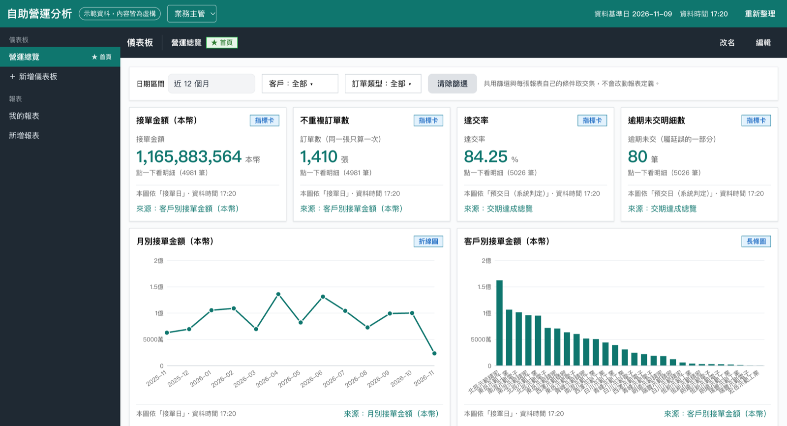
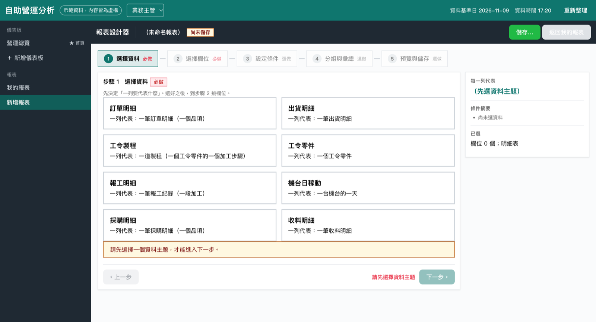

<h1 align="center">自助營運分析</h1>

<p align="center">
  給製造業主管的自助報表與儀表板：打開就看到自己的數字，想看更細就自己組報表，不用寫 SQL、不用找 IT。
</p>

<p align="center">
  <a href="https://selfservice-bi.onrender.com"><strong>線上 Demo</strong></a> ·
  <a href="docs/操作手冊.md">操作手冊</a> ·
  <a href="docs/自助報表與儀表板介紹.md">功能介紹</a>
</p>

<p align="center">
  
  
  
</p>



> **所有資料都是虛構的。** 客戶、供應商、機台與人員都由程式產生，名稱含「示範」二字，不對應任何真實公司。

## 線上 Demo

**<https://selfservice-bi.onrender.com>**

- 沒有登入。用左上角的下拉選單切換身分：業務主管、生產主管、採購主管、老闆、管理員。
- 站台跑在 Render 免費方案，閒置會休眠，第一次開啟可能要等幾十秒。
- 所有訪客共用同一份資料，你建的報表別人也看得到；站台重啟後會回到初始狀態。

## 特色

- **每個角色有自己的首頁**：業務看接單與交期，生產看完工、積壓與稼動，採購看金額、準時率與逾期未到，老闆看各部門摘要並一鍵跳到部門儀表板。
- **五步組報表**：選資料 → 選欄位 → 設條件 → 分組與彙總 → 預覽與儲存。欄位都來自白名單目錄，使用者碰不到 SQL。
- **報表一鍵變圖表**：指標卡、折線、長條、環圈、表格；圖表的數字直接取自報表，兩邊一定對得上。
- **點數字看明細**：點長條或指標卡，下鑽到組成這個數字的每一筆資料。
- **防呆的數字口徑**：系統知道「每一列代表什麼」，會擋下重複加總這類算錯的組法並說明原因。
- **預設版與個人版**：管理員把儀表板指派給角色；主管自己調整時另存個人版，不會被預設版更新覆蓋。



## 快速開始

需要 Node.js **22.23 以上**。執行期沒有相依套件，不必先 `npm install`。

```bash
git clone https://github.com/KerryHuang/selfservice-bi.git
cd selfservice-bi
npm start
```

開啟 <http://127.0.0.1:3100/>。第一次啟動會自動產生 Demo 資料庫。

不想開終端機的話，Windows 雙擊 `start.cmd`，macOS 雙擊 `start.command`。

### 環境變數

| 變數 | 預設 | 用途 |
|---|---|---|
| `PORT` | `3100` | 連接埠 |
| `HOST` | `127.0.0.1` | 綁定位址 |
| `DATA_DIR` | `data/` | `demo.db` 與 `store.json` 的存放目錄 |

## 部署到 Render

repo 附有 Render Blueprint（`render.yaml`）：免費方案、原生 Node 執行環境，不需要 Docker。在 Render 選 **New → Blueprint** 指向這個 repo 即可，push 到 `main` 會自動部署。

免費方案的磁碟不保留，重啟後會回到初始狀態，並以當天日期重新產生資料。

## 運作方式

| 部分 | 位置 | 說明 |
|---|---|---|
| 後端 | `server/` | Node 22 原生執行 TypeScript（不建置），`node:http`＋內建 `node:sqlite` |
| 前端 | `web/index.html` | 單一 HTML 檔，由後端在 `/` 提供 |
| 欄位目錄 | `config/topics.json` | 白名單：主題、欄位 → SQL 運算式、相關資料、比率 |
| Demo 資料 | `server/demo/`、`data/demo.db` | 啟動時自動產生的 SQLite 資料庫（不進 git） |
| 自建內容 | `data/store.json` | 報表、儀表板、各角色首頁（不進 git）；初始內容在 `data/seed.json` |

資料主題：訂單明細、出貨明細、工令製程、工令零件、報工明細、機台日稼動、採購明細、收料明細。

<details>
<summary><strong>Demo 資料怎麼產生</strong></summary>

啟動時如果 `data/demo.db` 不存在、損壞或結構版本不符，就自動產生一份：以當天為基準往前 24 個月，同一天產生的內容完全相同。

產生當天會記成**資料基準日**，畫面上的「今天」「本月」「上週」都以它計算，所以資料庫放久了也不會查不到資料。想換成最新日期，停掉站台、刪除 `data/demo.db` 再啟動。

</details>

<details>
<summary><strong>身分、權限與重設</strong></summary>

示範站**沒有登入**。左上角的下拉選單就是目前身分，前端以 `X-Viewer` header 告訴後端。這是模擬，不是權限控管，所以不要放真實資料。

畫面上沒有重設按鈕。要清掉所有自建報表、儀表板與個人版，用 API，或停掉站台後刪除 `data/store.json`：

```bash
curl -X POST -H "X-Viewer: admin" http://127.0.0.1:3100/api/reset
```

</details>

<details>
<summary><strong>上限與安全保護</strong></summary>

| 項目 | 值 |
|---|---|
| 明細列數 | 2,000（超過會標示截斷） |
| 彙總分組數 | 500（超過會請使用者縮小範圍） |
| 查詢結果快取 | 10 分鐘，所有人共用，最多 1,000 筆、合計 100,000 列；「重新整理」每人每分鐘一次 |
| 報表／儀表板數量 | 全站 200 份／50 份 |
| 單一項目／請求大小 | 32 KiB／64 KiB |

每支 SQL 在產生時與送出前各檢查一次：只允許 `SELECT`，禁止寫入與 DDL 關鍵字；使用者輸入一律走參數；查詢端以唯讀模式開啟資料庫。

</details>

## 開發

```bash
npm test             # 單元、API 與真實 SQLite 整合測試
npm install          # 只有型別檢查需要
npm run typecheck
```

整合測試會把報表結果和產生器獨立累計的數字對帳。

## 文件

| 文件 | 內容 |
|---|---|
| [操作手冊](docs/操作手冊.md) | 各角色與管理員的逐步操作 |
| [功能介紹](docs/自助報表與儀表板介紹.md) | 功能介紹與數字口徑 |
| [後端](docs/backend.md)／[前端](docs/frontend.md) | 後端 API 與前端結構 |

## 目前還沒有的功能

- 登入與正式權限控管（目前以左上角切換角色模擬）
- 排程寄送報表
- 自由輸入 SQL
